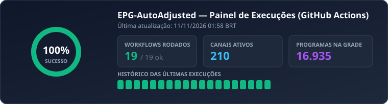
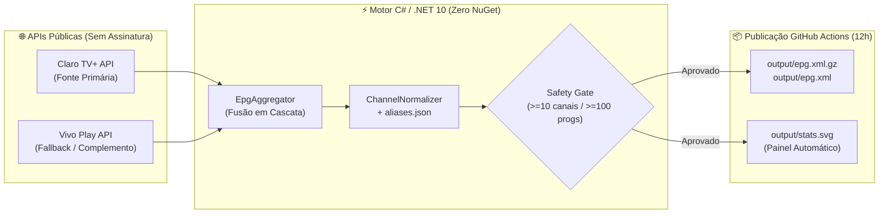

<div align="center">

# 📺 EPG-AutoAdjusted (PT-BR)

**Guia Eletrônico de Programação (XMLTV) autônomo, multi-fonte e automaticamente retrocompatível com qualquer lista M3U de terceiros.**

[](https://github.com/CesarOvies/EPG-AutoAdjusted/actions/workflows/update-epg.yml)
[](https://github.com/CesarOvies/EPG-AutoAdjusted/actions/workflows/ci.yml)
[](https://dotnet.microsoft.com/)
[](CONTRIBUTING.md)
[](LICENSE)
[](https://github.com/CesarOvies/EPG-AutoAdjusted/stargazers)
[](https://github.com/CesarOvies/EPG-AutoAdjusted/network/members)

<br />



<br />

[🔗 **Links para o Player**](#-links-diretos-para-o-player-iptv) •
[⚙️ **Como Funciona**](#️-arquitetura-e-funcionamento) •
[🍴 **Fazer Fork**](#-como-fazer-fork-seu-próprio-servidor-grátis) •
[🤝 **Contribuir**](#-como-contribuir) •
[💡 **Motivação**](#-motivação--agradecimentos)

</div>

---

## 🔗 Links Diretos para o Player IPTV

Adicione **uma única vez** no seu player favorito (atualização automática na nuvem a cada **12 horas** sem mudar de endereço):

| Formato | Recomendação | Link Direto (Copiar e Colar) |
| :--- | :--- | :--- |
| 📦 **XMLTV Compactado (`.gz`)** | ⭐ **Recomendado** (~10x mais leve e rápido) | `https://raw.githubusercontent.com/CesarOvies/EPG-AutoAdjusted/main/output/epg.xml.gz` |
| 📄 **XMLTV Descomprimido (`.xml`)** | Para players antigos sem suporte a GZip | `https://raw.githubusercontent.com/CesarOvies/EPG-AutoAdjusted/main/output/epg.xml` |

<details>
<summary>📱 <b>Clique para ver como configurar no TiviMate / IPTV Smarters</b></summary>
<br />

1. Abra as **Configurações (Settings)** do seu player -> **EPG (Guia de TV)** -> **Fontes de EPG (EPG Sources)**.
2. Clique em **Adicionar Fonte (Add Source)** e cole a URL `.xml.gz` acima.
3. Defina essa fonte como **Padrão** na sua lista de reprodução e clique em **Atualizar EPG**.
4. **Pronto!** O player vai associar automaticamente canais `SD`, `HD`, `FHD`, `4K`, `H265`, `FHD¹` e afiliadas sem que você precise editar sua lista `.m3u`.
</details>

---

## ⚙️ Arquitetura e Funcionamento



1. **Coleta Multi-Fonte em Cascata:**
   - **Fonte Primária (`ClaroTV+`):** Consulta diretamente a API pública de catálogo e grade da Claro TV+.
   - **Fonte Secundária / Fallback (`VivoPlay`):** Preenche canais ausentes na Claro ou assume automaticamente caso a API principal falhe.
2. **Auto-Ajuste Retrocompatível (`SD`, `HD`, `FHD`, `4K`, `UHD`, `H265`, `FHD¹`, `HD²`):**
   - Limpa sufixos de resolução do nome original da operadora e injeta dezenas de tags `<display-name>` dentro do mesmo `<channel>`, incluindo variações com/sem acento, abreviações (`TC ACTION`, `DISCOVERY H&H`, `HBO 2`) e afiliadas regionais (`Globo`, `Record`, `SBT`, `Band`).
   - Qualquer lista M3U de terceiros reconhece automaticamente todas as variações do canal **sem tocar no arquivo `.m3u`**.
3. **Trava de Segurança (`Safety Gate`) e Testes Automatizados (`xUnit`):**
   - Toda alteração passa pela suíte de testes unitários (`dotnet test`) e só sobrescreve os arquivos de saída se a coleta retornar volume íntegro de canais e programas.

---

## 🍴 Como Fazer Fork (Seu Próprio Servidor Grátis)

Quer rodar uma instância **100% independente** na sua própria conta do GitHub? Leva menos de 1 minuto:

1. Clique no botão [**Fork**](https://github.com/CesarOvies/EPG-AutoAdjusted/fork) no topo direito desta página.
2. No seu repositório criado, vá na aba **Actions** e clique em **"I understand my workflows, go ahead and enable them"**.
3. Em **Settings -> Actions -> General -> Workflow permissions**, selecione **"Read and write permissions"** e salve.
4. O código já detecta automaticamente o nome do seu repositório via `GITHUB_REPOSITORY`, atualizando o seu próprio `epg.xml.gz` e o seu próprio gráfico `stats.svg` a cada 12h!

👉 Veja o passo a passo completo em [**CONTRIBUTING.md**](CONTRIBUTING.md).

---

## 🤝 Como Contribuir

Sentiu falta de algum apelido de canal da sua lista M3U ou quer adicionar uma nova operadora?

<div align="center">

| 📺 **Faltou um canal da sua M3U?** | 🛠️ **Quer enviar um Pull Request?** | 🐛 **Encontrou algum erro?** |
| :---: | :---: | :---: |
| Edite apenas o [`aliases.json`](aliases.json) ou abra um pedido rápido sem precisar programar. | Nossa pipeline de **CI** testa automaticamente seu código e valida o `aliases.json`. | Reporte falhas de grade ou sugestões de melhoria. |
| [**Solicitar Canal / Apelido →**](https://github.com/CesarOvies/EPG-AutoAdjusted/issues/new?template=channel-request.yml) | [**Ler Guia de Contribuição →**](CONTRIBUTING.md) | [**Abrir Issue de Bug →**](https://github.com/CesarOvies/EPG-AutoAdjusted/issues/new?template=bug-report.yml) |

</div>

### Comandos para Desenvolvimento Local

```powershell
# 1. Rodar suíte completa de testes unitários (xUnit)
dotnet test -c Release

# 2. Rodar auto-teste rápido de normalização e aliases
dotnet run --project src/EpgGenerator -c Release -- --self-check

# 3. Gerar EPG completo localmente (2 dias)
dotnet run --project src/EpgGenerator -c Release -- --days 2 --output output --aliases aliases.json
```

---

## 🌟 Comunidade & Contribuidores

Painel atualizado automaticamente com todos que contribuem para manter o guia cada vez mais completo:

<div align="center">

<a href="https://github.com/CesarOvies/EPG-AutoAdjusted/graphs/contributors">
  
</a>

<br /><br />


</div>

---

## 💡 Motivação & Agradecimentos

Este projeto nasceu de uma dor pessoal: a dificuldade de manter a grade de programação (EPG) sempre organizada e **automaticamente retrocompatível com qualquer lista de IPTV de terceiros** — onde o mesmo canal costuma aparecer fragmentado em diversas variações de nomenclatura e sufixos (`SD`, `HD`, `FHD`, `4K`, `H265`, `FHD¹`, `HD²`, abreviações ou `tvg-id` divergentes), fazendo com que os guias tradicionais só funcionassem em uma das resoluções ou exigissem edição manual constante da lista M3U.

Agradecimentos especiais ao projeto [**limaalef/BrazilTVEPG**](https://github.com/limaalef/BrazilTVEPG), que serviu como grande inspiração e referência inicial para a concepção desta solução.

---

## ⚖️ Aviso Legal (Disclaimer)

- Este projeto **não fornece, não hospeda, não transmite e não distribui** nenhum fluxo de vídeo, áudio, sinal de TV ou listas de reprodução (`.m3u` / `.m3u8`).
- O repositório atua exclusivamente como um agregador automatizado de metadados públicos de grade de programação (horários, títulos e sinopses) disponibilizados publicamente na web para fins informativos.
- Todas as marcas, nomes de canais e logotipos pertencem aos seus respectivos proprietários.

## 📄 Licença

Distribuído sob a licença [**MIT**](LICENSE).
